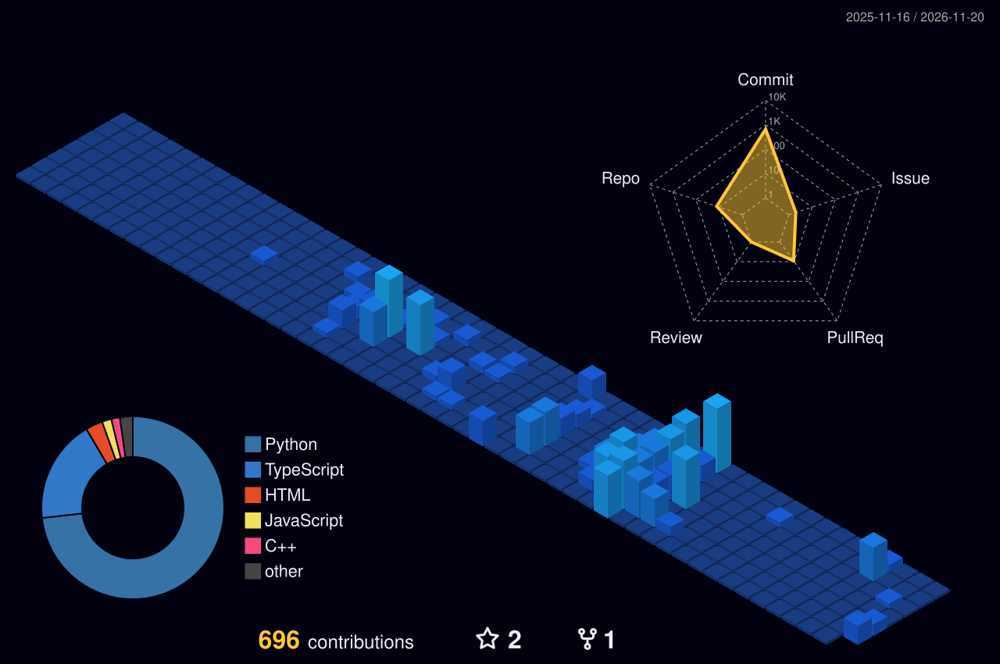

## 🛠️ Core Stack

<picture>
  <source media="(prefers-color-scheme: dark)" srcset="https://skillicons.dev/icons?i=python%2Cpytorch%2Copencv%2Ccpp%2Cros%2Cqt%2Clinux%2Cts%2Creact%2Cspring%2Cdocker%2Caws&perline=6&theme=dark" />
  <source media="(prefers-color-scheme: light)" srcset="https://skillicons.dev/icons?i=python%2Cpytorch%2Copencv%2Ccpp%2Cros%2Cqt%2Clinux%2Cts%2Creact%2Cspring%2Cdocker%2Caws&perline=6&theme=light" />
  
</picture>

**AI & 3D Vision** &nbsp;·&nbsp; `PyTorch` · `TensorRT` · `OpenCV` · `YOLO / Ultralytics` · `Multi-view Geometry` · `vLLM` · `RAG (pgvector)` · `Hugging Face / PEFT`

**Robotics & Edge** &nbsp;·&nbsp; `ROS 2` · `C / C++` · `Linux` · `Jetson / CUDA` · `Qt / QML` · `CARLA` · `ESP32` · `MQTT`

**Product Engineering** &nbsp;·&nbsp; `TypeScript` · `React` · `Three.js` · `Spring Boot` · `FastAPI` · `PostgreSQL` · `WebSocket`

**Infra & CI** &nbsp;·&nbsp; `Docker` · `AWS (EC2 · S3 · GPU)` · `Jenkins` · `GitLab CI` · `Nginx`

## 📊 Activity

<picture>
  <source media="(prefers-color-scheme: dark)" srcset="https://raw.githubusercontent.com/Janjonghwa/Janjonghwa/output/profile-night-view.svg" />
  <source media="(prefers-color-scheme: light)" srcset="https://raw.githubusercontent.com/Janjonghwa/Janjonghwa/output/profile-green.svg" />
  
</picture>

## 🤝 Connect

프로젝트와 협업 이야기는 언제든 편하게 보내주세요.

  

